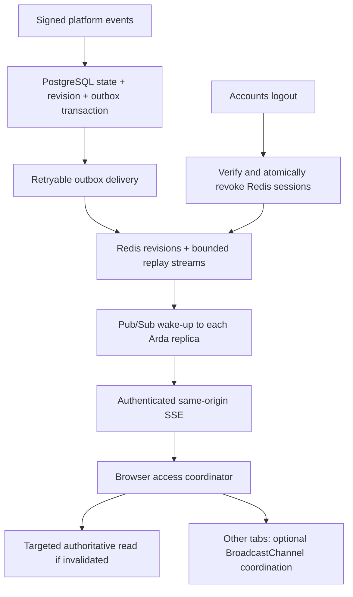

# ADR-014: Event-driven browser access synchronization

Date: 2026-11-22
Status: Architecture baseline; implementation and live acceptance pending.
Scope: Arda. No platform source, configuration or production changes in this ADR.

## Problem and evidence

AccountGate listens for focus, visibility, storage and throttled input events.
Every successful /auth/session response increments revision, even if sessionScope
is unchanged. EntitlementGate observes revision and user object identity, fetches
/api/entitlement and hides its mounted children while checking. Consequently a
normal tab switch renders the full checking-access screen. Input can also cause
this cycle. In-flight coalescing does not prevent sequential duplicate triggers.

/auth/session resolves the Redis-backed RP session; Accounts status is read only
when central_next_check_at is due, and near-expiry tokens may refresh. The entry
entitlement endpoint directly reads authoritative C2 and user product assignment.
This is access synchronization, not business-data loading.

Existing verified inputs are OIDC backchannel logout and signed provisioning
events (tenant.provisioned, tenant.deprovisioned, subscription_changed and
grant.invalidated). Logout deletes Redis session/token keys; browser detection
currently waits for another request. Provisioning commits in PostgreSQL and
invalidates only the receiving process's 45-second C2 cache. No browser event
transport, distributed cache revision or cross-tab coordinator exists today.
No verified upstream event for arbitrary role/product-assignment changes was
found in these consumers. Do not invent one or promise immediate delivery for it.

## Decision

Use committed change events as the primary synchronization path, with same-origin
SSE to browsers. Remove periodic frontend access queries and focus-driven full
entitlement reloads only after reliable delivery and recovery are implemented.
Messages are invalidation hints, never authority to grant access. Business routes
continue resolving session and enforcing current permissions/quotas server-side.

Pub/Sub is a low-latency wake-up only. Persistent revisions and bounded replay
streams provide recovery. No exactly-once delivery claim; handlers are idempotent.
Do not replace these pieces with bare process emitters, bare Pub/Sub or timers
that repeatedly query platform entitlement.

## Producers and commit consistency

1. In the lifecycle transaction, write workspace access revision and a durable
   notification outbox row alongside accepted mutations/delivery dedup. Apply the
   same operation to reconciliation changes. Dedup/stale deliveries must not
   regress revisions or extend retention. Versionless invalidation advances a
   separate local revision, never the platform lifecycle seq.
2. The outbox dispatcher applies each event idempotently to Redis: compare revision,
   update scope revision, append a bounded stream record, then publish a wake-up
   atomically (Lua or equivalent). Mark sent only after Redis success. Crash after
   Redis success is safe to retry. Retain and alert on failures; no silent discard.
   A bounded worker wake interval is queue delivery, not platform access polling.
3. Redis session revocation atomically deletes identity/tokens, updates the sid
   index and records a terminal event for each affected RP session. Do not leave
   deletion and notification as independent writes. Preserve retryable failure
   behavior at /auth/backchannel-logout. Redis TTL expiration is not a reliable
   notification producer: handle absolute session expiry separately.
4. Local explicit logout also emits revocation. Identity/scope changes from token
   rotation trigger a scope invalidation. Audit all actual producers before rollout.
5. No grant.invalidated event is presumed to cover role or product assignment
   changes. Confirm producer contracts; file detailed platform issues for missing
   events, coverage or routing. Keep on-request authority and the existing Accounts
   next-check deadline contract until an approved replacement exists.

New outbox/revision tables require DDL-owned migrations and the existing controlled
database pipeline. Do not create tables at app startup or in Prisma-only changes.

## Shared revisions and cache correctness

Separate session, workspace entitlement and user-assignment scopes. Namespace
everything by product and deployment environment; do not mix beta/prod Redis.
Filter user-level invalidations by trusted organization/workspace/subject. Never
broadcast the details of one user's access changes to all workspace members.

Replace process-only cache generations with a shared workspace revision (and
subject assignment revision where applicable). A cached result is usable only
within its bounded lifetime and matching revision. Recheck generation around an
in-flight authoritative read so a concurrent invalidation cannot repopulate stale
authority. Missed Pub/Sub cannot make another replica reuse a stale revision.
Shared revisions may require a cheap local Redis read on actual business requests;
this is deliberate, distinct from recurring platform queries while users are idle.

TTL remains an on-demand freshness bound, not a timer that fetches C2. Exhaustion,
purchase and role enforcement are server-side. Events alone are not sufficient
authorization and cannot replace existing resource-level checks.

## SSE protocol and security

Proposed endpoint: GET /api/access/events, Node runtime, dynamic, same-origin
HttpOnly cookie authentication, no token in URL, no public CORS. Validate Origin
when provided and reject cross-site Fetch Metadata. Do not trust client-supplied
workspace/subject identifiers. Derive all channel subscriptions from the current
verified RP session. Logs contain no rpsid, sid, tokens or personal claims.

Proposed browser messages (not new upstream platform wire contracts):

| Type | Meaning | Action |
| --- | --- | --- |
| sync | Current authorized scope handle and revision tuple | Compare against the accepted snapshot |
| session.revoked | Current session is invalid | Hide/inert business surface immediately; enter recovery/signed-out state |
| scope.invalidated | Identity, org, workspace or role may have changed | Block old scope, re-resolve session; reload if scope changed |
| access.invalidated | Subscription/product assignment needs authoritative read | Coalesce one relevant read; suspend protected interactions until resolved |
| resync.required | Replay gap or transport continuity lost | One session/revision synchronization, then fetch only changed access |

Payload contains opaque scope handles, monotonic local revisions and reason enums,
not entitlements, quotas, tokens, raw session ids or document data. Browser messages
cannot set connected=true or accept a new scope without server confirmation.
Terminal events override earlier successful responses. Reject stale response
generations and dedup events so late results cannot reopen a revoked surface.

Handshake order: register wake-up listener, take authorized revision/stream
high-water snapshot, revalidate the session, replay changes after that watermark,
then release buffered events. The accepted bootstrap access response carries its
revision tuple. Compare both to avoid the read/subscription race. Revision mismatch
causes one targeted refresh, not an unconditional second bootstrap C2 read.

Use an opaque bounded per-connection resume cursor encoding server-validated scope
and revision tuple (or an equivalent server-side handle); raw client stream offsets
must not choose another tenant's history. Last-Event-ID is untrusted input and
bounded. If expired, trimmed or mismatched, send resync.required. Unauthorized
connections return no protected history. EventSource error handling must stop
reconnect storms on terminal logout; use one bounded session probe to distinguish
anonymous from transient transport failure, then stop or back off with jitter.

For invalidation/expiry, deliver a terminal hint when possible and close. Network
loss is not logout. A stream holds a fixed session-expiry deadline; heartbeats do
not extend login, refresh tokens, call Accounts or check C2. Validated token refresh
on ordinary requests may update a stream's deadline through a local event; otherwise
the deadline causes one revalidation/reconnect, not an assumed renewable session.

## Browser lifecycle and UI

First entry has no accepted authority: keep the existing blocking checking screen.
Once connected, a healthy tab switch causes zero session/C2 requests and no loading
screen. Do not couple a successful unchanged session check to entitlement revision.
Only an actual invalidation or recovery gap schedules a coalesced authoritative read.

Keep accepted business content mounted during a subscription invalidation; disable
protected interaction while resolving, using a small pending indicator rather than
the full entry screen. Confirmed denial shows the appropriate entry state. Unknown
access after a failed required read remains blocked with a retry action, not a
purchase suggestion or indefinite reuse of stale authorization. Actual session
revocation/scope change hides old content immediately. Preserve same-scope drafts
using the existing recovery rule; never carry drafts across identity scopes.

Separate user activity from synchronization. Removing input-triggered polling must
not fabricate activity via SSE heartbeats or silently break the platform idle-time
contract. Confirm whether explicit activity reporting is required; if so, batch real
input using its documented contract independently of entitlement checks.

Focus alone is not a recovery gap. On pageshow/persisted, reconnect, offline->online,
or a detected transport/liveness gap after browser suspension, synchronize once.
Use an inbound-frame timestamp and a local deadline comparison on resume, not a
periodic permission refresh. A tiny recovery read may hold protected interaction;
do not replace the whole page while checking unchanged access. Retain the existing
Accounts server-side due-status checks on real requests as defense against missed
upstream logout until the producer contract supports stronger guarantees.

## Multiple tabs and replicas

Correctness must work with one SSE connection per tab. Initial release uses this
bounded model with explicit per-session/per-IP limits, avoiding mandatory fragile
leader election. BroadcastChannel is same-origin only and is an optimization:
share invalidation hints, never tokens or positive authorization. Ignore hints for
a different opaque scope, dedup, and never rebroadcast received hints.

A later SharedWorker or Web Locks based single-connection coordinator is allowed
only with tested leader loss, browser support and follower recovery. Do not claim
cross-origin delivery from BroadcastChannel. Other products reach Arda through
platform backchannel/events, not browser channel names.

Each server replica has a shared Redis subscriber with local authorized connection
registries, not a Redis client per browser. Pub/Sub wakes replay from the appropriate
bounded stream. Loss of the subscriber disconnects affected SSE clients so recovery
is explicit. Every replica observes revision checks independently of notifications.

## Resource bounds and operations

Initial tunables to verify in beta, not capacity promises: heartbeat 25 seconds;
per-connection outbound queue <=64KiB; event payload <=2KiB; retry backoff 1-30s
with jitter. Close slow consumers with resync on reconnect. Bound connections and
reconnects per session/IP; never evict another identity's connection via user input.

Bound streams by count (initial 256 events/scope) and retention (initial 24h for
workspace hints; session history no longer than session lifetime plus recovery
grace). Cleanup must be implemented, not assumed from stream trimming. Trim/gap
always falls back to authoritative synchronization. Revisions have a durable
workspace source in PostgreSQL and an epoch across Redis restore/reset; epoch
changes force resync, never compare restored lower counters as current authority.

At 25-second heartbeat, 1000 open tabs imply about40 lightweight frames/second,
not40 platform reads/second; actual sockets, memory and bandwidth require load
measurement. No extra broker or browser polling service is introduced.

SSE requires no proxy buffering/caching/transformation, flushed frames, compatible
compression, adequate idle timeout and graceful drain. Verify the real shared edge
and HTTP protocol with management-owned routing. File a platform issue for missing
configuration support; do not install an Arda vhost or change platform variables.
Keep stream availability in diagnostics; never claim it proves all access sources
healthy. Observe active streams, reconnects, outbox age, delivery latency, gaps,
cache revision mismatches, suppressed duplicate reads and blocked-state duration.

## Implementation sequence and acceptance

1. Confirm current platform event coverage, idle contract and edge streaming support.
   Publish gaps as issues; do not invent new event types or assume upstream coverage.
2. Implement DDL/outbox, atomic Redis revocation, replay and shared revisions. Test
   crash windows, rollback, duplicate/out-of-order delivery and two replicas.
3. Add authenticated SSE and recovery handshake with scope filtering, expiry,
   backpressure, trim/reset and proxy tests. Feature flag remains off by default.
4. Add one browser coordinator; decouple AccountGate/EntitlementGate checks and UI.
   Enable in beta only after recovery and server authorization regressions pass.
5. Test 100 ordinary tab switches with zero access fetches/zero entry-screen flashes;
   subscription change produces one coalesced refresh; session revoke reaches idle
   open tabs without waiting for clicks. Same-scope drafts survive; cross-scope data
   never reappears. Measure commit-to-visible invalidation (target p95 <=2s under
   healthy transport), reconnect once, offline gaps and token/session expiry.
6. Verify restart between DB commit and publish, duplicate logout, Redis restart,
   outbox backlog, stale in-flight C2, malformed cursors, cross-tenant denial,
   background suspension/BFCache, slow consumers and multi-tab limits. Measure
   production-like connection memory and upstream query counts before promotion.
7. Promote the validated image with required production approval. Record actual
   results and limitations. Rollback disables SSE and restores the previous
   access path without bypassing authorization or dropping durable events; do not
   describe a rollback's old flashing behavior as the final desired architecture.

Existing background provisioning reconciliation remains a correctness repair
mechanism; this ADR does not remove it. Heartbeats, delivery retries, expiry and
reconciliation timers have different purposes from browser entitlement polling.
Immediate UI convergence is conditional on upstream event coverage and healthy
delivery. Missing upstream events remain an explicit gap, not a solved guarantee.
